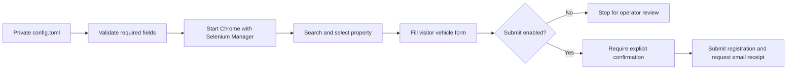

# Register2Park Workflow

[](https://github.com/YuvrajKashyap/register2park-automation/actions/workflows/ci.yml)

An operator-controlled Selenium workflow for authorized guest parking registration. It removes repetitive browser input while keeping property details, unit information, vehicle data, and email addresses out of the repository.

The safe default is a review run. The script opens the public registration flow, selects the configured property, fills the vehicle form, and stops before the final submission. An actual registration requires an explicit `--submit` flag and a typed confirmation.

## What this demonstrates

- A third-party browser workflow broken into clear, inspectable steps
- Private local configuration with validation and redacted console output
- Explicit waits instead of timing-dependent clicks
- Selenium Manager instead of a machine-specific ChromeDriver path
- Deterministic property-result selection when several matches appear
- A dry-run default and an explicit boundary around external side effects
- Unit tests, static checks, and GitHub Actions CI without touching the live form

## Safety boundary

Use this project only for a property and vehicle registration you are authorized to manage. It does not bypass parking rules, access controls, registration limits, payments, or site validation.

- No real property, resident, vehicle, or contact details are committed.
- Review mode never clicks the final vehicle-information submission button.
- Submit mode requires `--submit` and an interactive `SUBMIT` confirmation.
- Scheduled use additionally requires `--yes`, making unattended submission visible in the command itself.
- Logs describe completed steps without printing configuration values.

## Workflow



## Local setup

Requirements:

- Python 3.11 or newer
- Google Chrome
- Authorization to submit the registration

Create and activate a virtual environment:

```powershell
python -m venv .venv
.\.venv\Scripts\Activate.ps1
python -m pip install -r requirements.txt
```

Copy the configuration template:

```powershell
Copy-Item config.example.toml config.toml
```

Fill `config.toml` with your private values. The file is ignored by Git.

```toml
[property]
query = "YOUR_PROPERTY_SEARCH_TERM"
result_match = "EXPECTED_TEXT_FROM_THE_CORRECT_RESULT"

[resident]
unit = "YOUR_UNIT_OR_APARTMENT"

[vehicle]
make = "YOUR_VEHICLE_MAKE"
model = "YOUR_VEHICLE_MODEL"
plate = "YOUR_LICENSE_PLATE"

[contact]
email = "YOUR_EMAIL_ADDRESS"
```

## Run it

Start with the default review mode:

```powershell
python main.py
```

The included Windows launcher does the same thing:

```powershell
.\run_bot.bat
```

After you have visually confirmed the current site flow and your configuration, enable a real submission:

```powershell
python main.py --submit
```

The command asks you to type `SUBMIT` before opening the browser. For an intentionally scheduled run, the non-interactive form is:

```powershell
python main.py --submit --yes --headless --keep-open-seconds 0
```

Use `--help` to see timeout, browser, and configuration options.

## Verification

Install the development tools and run the local quality gate:

```powershell
python -m pip install -r requirements-dev.txt
ruff check .
pytest
python -m compileall -q main.py register2park tests
```

GitHub Actions repeats these checks on every push and pull request. CI deliberately does not run the browser against Register2Park because automated tests should not create third-party parking registrations.

## Project structure

```text
main.py                    small command entry point
register2park/config.py    TOML loading, validation, and redaction
register2park/flow.py      Selenium browser workflow
register2park/cli.py       arguments and submission confirmation
config.example.toml        tracked placeholder configuration
tests/                     offline unit tests
```

## Known limitations

- Register2Park is a third-party site and can change its labels, selectors, or workflow without notice.
- The operator must review the current site and parking rules before enabling submission.
- Property matching depends on the text returned by the live search result.
- Email confirmation is best effort after a successful registration.
- This project is not affiliated with or endorsed by Register2Park.

## Status

Maintained as a small personal workflow automation and engineering case study. The repository contains no production configuration or personal registration data.
